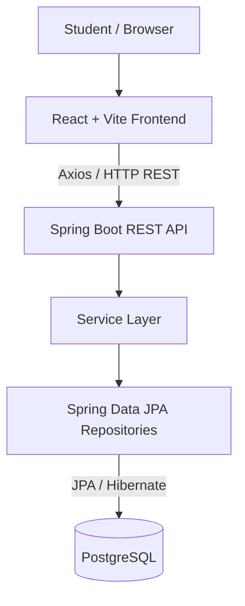
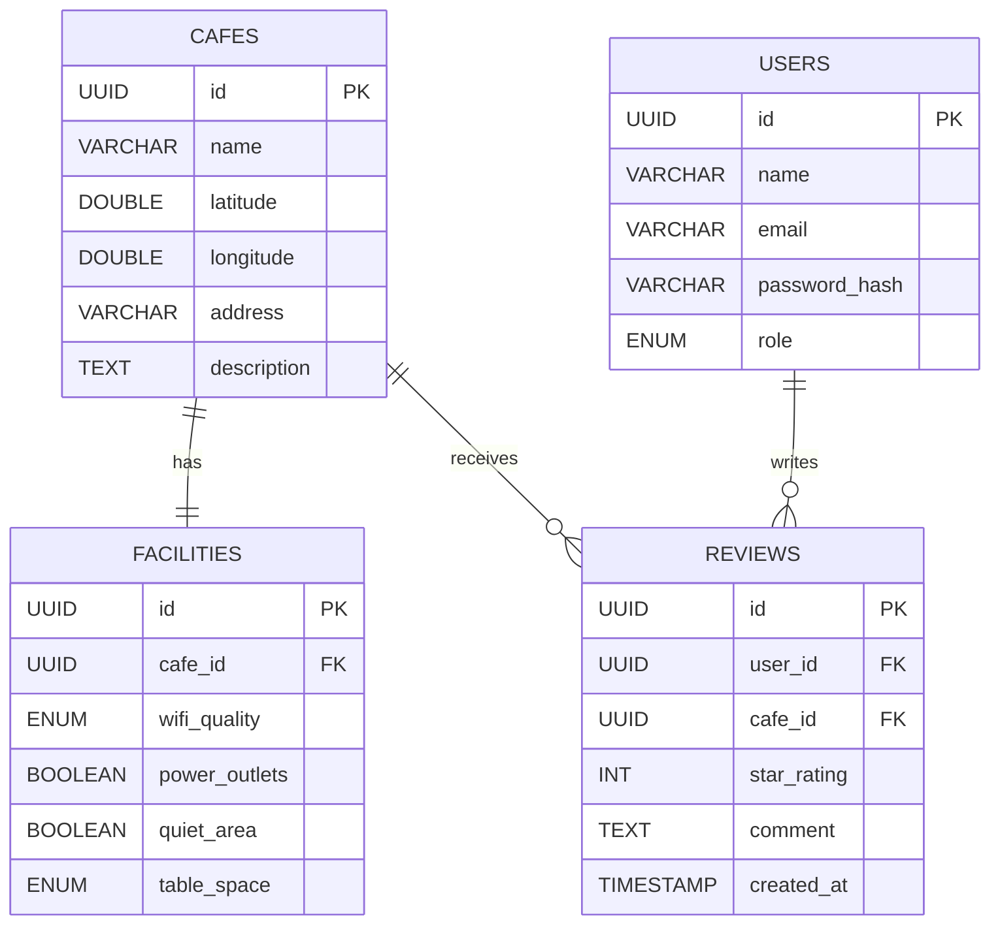

<div align="center">

# 📍 WHERE TO STUDY

**Find cafés and study-friendly spaces in Riga, Latvia.**

A full-stack web application that helps students explore study spots on an interactive map and compare them by Wi-Fi quality, power outlets, quiet areas, and community reviews.

**Erasmus+ team project · Riga Technical University (RTU) · 2026**


</div>

## Overview

**Where to Study** is a university software engineering project developed collaboratively by **five students during the Erasmus+ exchange programme at Riga Technical University in Latvia**.

The application addresses a practical student need: finding a comfortable place to study in Riga. Rather than checking multiple café websites or reviews, users can explore locations and relevant study-related amenities in one interface.

> **Project context:** Academic group project. This repository presents the team's shared work as part of my software development portfolio; it is not a claim of sole authorship.

## Key Features

| Feature | Description |
| --- | --- |
| 🗺️ Interactive map | Explore café locations in Riga using Leaflet markers. |
| 🔍 Study-focused filters | Filter locations by Wi-Fi quality, power outlets, quiet areas, and other facilities. |
| ☕ Café details | View location information, amenities, and available community feedback. |
| ⭐ Ratings and reviews | Browse and submit star ratings and written reviews. |
| 🎨 Responsive interface | React-based UI with a modern dark visual style. |
| 🔗 REST API | Spring Boot endpoints for cafés, filters, and reviews, with Swagger/OpenAPI documentation. |
| 🌱 Sample data | Initial café, user, and review data for local development and demonstration. |

## My Contributions

**Çağdaş Öztürk** — [@CagdsOz](https://github.com/CagdsOz)

As a member of the five-person development team, my contributions included:

- **Application development:** Contributed to implementing and developing the web application in collaboration with other team members.
- **PostgreSQL database:** Worked on the application's PostgreSQL database and its use in the project.
- **Software testing documentation:** Prepared the project's **test report** to document the testing work and results.

These contributions were part of a shared team effort; the overall application was developed collaboratively.

## Tech Stack

| Layer | Technologies |
| --- | --- |
| Frontend | React 19, Vite 7, JavaScript, React-Leaflet, Leaflet, Axios, Lucide React |
| Backend | Java 21, Spring Boot 3.4.3, Spring Web, Spring Data JPA, Hibernate, Bean Validation |
| Database | PostgreSQL, relational data model |
| API documentation | SpringDoc OpenAPI / Swagger UI |
| Development | Maven, npm, Git, GitHub, Docker Compose (for PostgreSQL) |

## System Architecture



The frontend presents the study locations and review interface. The Spring Boot backend handles API requests and application logic, while PostgreSQL stores the persistent data.

## Database Model

The core database model includes cafés, facilities, reviews, and users.



The application uses JPA/Hibernate for persistence. During local setup, its development configuration can create or update tables, and the `DataSeeder` can populate the database with **5 example cafés, 2 test users, and 7 sample reviews**.

## Getting Started

### Prerequisites

- **Java JDK 21** — verify with `java -version`
- **Node.js 20.19+ or 22.12+** and npm — verify with `node -v` and `npm -v`
- **PostgreSQL 15+**, either installed locally or provided through **Docker Compose**
- Git

### 1. Clone the repository

```bash
git clone https://github.com/CagdsOz/where-to-study.git
cd where-to-study
```

### 2. Start PostgreSQL

**Option A — Docker Compose (recommended if Docker is installed)**

From the project root:

```bash
docker compose up -d db
```

The included `docker-compose.yml` starts a local PostgreSQL 15 service with a database named `wheretostudy` on port `5432`.

**Option B — Existing local PostgreSQL installation**

Create the database with the PostgreSQL command-line client:

```bash
psql -U postgres -c "CREATE DATABASE wheretostudy;"
```

Or create a database named `wheretostudy` with pgAdmin.

### 3. Check the database connection

The backend configuration is located at:

`backend/src/main/resources/application.properties`

For the provided **local development setup**, the database connection is:

```properties
spring.datasource.url=jdbc:postgresql://localhost:5432/wheretostudy
spring.datasource.username=postgres
spring.datasource.password=postgres
```

If you use a different database username, password, host, or port, update your **local configuration** accordingly. These are development-only example credentials; do not reuse them for a deployed application or commit real secrets to Git.

### 4. Run the backend

Open a terminal at the project root.

**Windows PowerShell:**

```powershell
cd backend
.\mvnw.cmd spring-boot:run
```

**macOS / Linux:**

```bash
cd backend
chmod +x mvnw
./mvnw spring-boot:run
```

The API should be available at **http://localhost:8080**.

Check the café endpoint:

`http://localhost:8080/api/cafes`

API documentation:

`http://localhost:8080/swagger-ui.html`

### 5. Run the frontend

In a **second terminal**, start from the project root:

```bash
cd frontend
npm install
npm run dev
```

Open **http://localhost:5173** in your browser. Keep the backend and frontend processes running while using the application.

## API Overview

| Method | Endpoint | Purpose |
| --- | --- | --- |
| `GET` | `/api/cafes` | List cafés and apply optional facility filters. |
| `GET` | `/api/cafes/{id}` | Retrieve details for one café. |
| `GET` | `/api/cafes/{cafeId}/reviews` | Retrieve reviews for a café. |
| `POST` | `/api/reviews` | Submit a new review. |

Example café filters include `wifiQuality`, `powerOutlets`, `quietArea`, `tableSpace`, `groupFriendly`, and `voiceMeetings`.

**Example requests:**

```bash
curl http://localhost:8080/api/cafes
curl "http://localhost:8080/api/cafes?wifiQuality=FAST&powerOutlets=true"
```

For request schemas and other details, explore Swagger UI while the backend is running.

## Project Structure

```text
where-to-study/
├── backend/                  # Spring Boot REST API
│   ├── src/main/java/       # Controllers, services, repositories, models, DTOs
│   ├── src/main/resources/  # Application configuration
│   └── pom.xml               # Java / Maven dependencies
├── frontend/                 # React + Vite application
│   ├── src/components/      # Map, café cards, reviews, filters
│   ├── src/services/        # API communication
│   └── package.json          # Frontend dependencies and scripts
├── docker-compose.yml       # PostgreSQL development container
└── README.md
```

## Testing & Documentation

Testing was part of the team's software engineering workflow. **I prepared the project's test report** as one of my contributions, documenting the testing work and its results.

For interactive API inspection and manual verification, run the backend and use the Swagger UI at `http://localhost:8080/swagger-ui.html`.

## Team & Acknowledgements

This project was completed by a **five-member Erasmus+ student team at Riga Technical University (2026)**.

- **Çağdaş Öztürk** — [GitHub](https://github.com/CagdsOz)

Thanks to all teammates for their contributions to the shared project.

---

<div align="center">

*Built as an Erasmus+ software engineering team project — helping students find their next study spot in Riga.*

</div>
